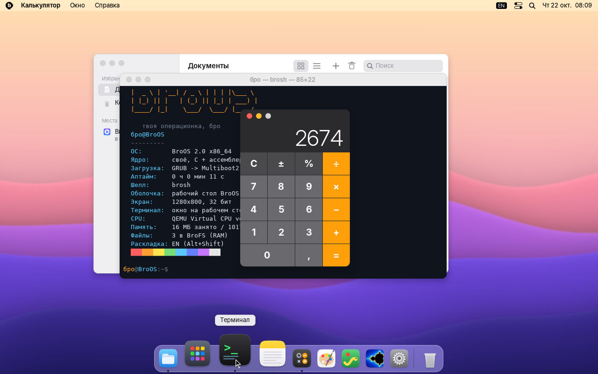
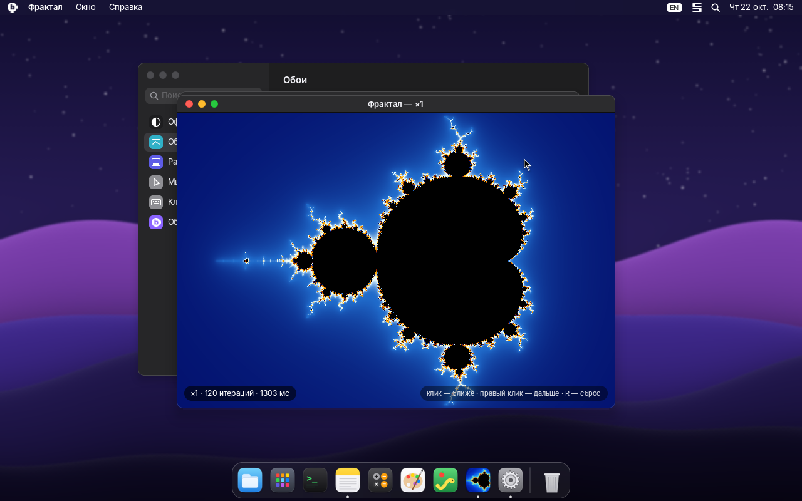

# BroOS 2.0 «Байкал»

Своя 64-битная операционная система с графическим рабочим столом в стиле macOS,
написанная с нуля на C и ассемблере: своё ядро, свой оконный менеджер, свои
программы. Linux внутри нет. Грузится с флешки на обычном ПК (x86-64) в режимах
**UEFI** и **BIOS (Legacy/CSM)**, работает целиком в оперативной памяти и не
трогает диски компьютера: Windows или Linux на жёстком диске останутся как были.





## Что есть

**Рабочий стол**
- Экран входа с размытыми обоями и большими часами.
- Полупрозрачная строка меню с размытием (vibrancy), меню программ, часы,
  раскладка, Пункт управления, Spotlight.
- Dock с увеличением значков под указателем, подписями, индикаторами запущенных
  программ и подпрыгиванием при запуске. Корзина в Dock.
- Окна со скруглёнными углами и мягкими тенями, кнопки-«светофоры», перетаскивание,
  изменение размера за правый нижний угол, разворачивание двойным кликом по заголовку.
- Анимации: плавное появление и закрытие окон, сворачивание «джинном» в Dock,
  разворачивание, Launchpad, Spotlight.
- Launchpad (F4), Spotlight с поиском программ и файлов и калькулятором прямо в
  строке поиска (Ctrl+Пробел), переключатель программ (Alt+Tab).
- Светлая и тёмная темы, 7 цветов акцента, трое обоев.
- Чёткая картинка на больших экранах: от 2560×1600 и на 4K всё рисуется в 2×.
- Сглаженные шрифты (Inter) с кириллицей.

**Программы**
- **Файлы** — значки и список, поиск, создание, переименование (F2), Корзина.
- **Текст** — редактор с выделением, буфером обмена, сохранением и вопросом
  «Сохранить изменения?» при закрытии.
- **Терминал** — шелл brosh: история, Tab-дополнение, `neofetch`, `calc`, `ls`,
  `cat`, `open <программа>`, `dmesg` и другие (`help`).
- **Калькулятор** — классический, мышью и с клавиатуры.
- **Рисовалка** — рисование мышью, 10 цветов, 4 кисти, ластик.
- **Змейка** и **Фрактал** (множество Мандельброта: клик — ближе, правый клик — дальше).
- **Настройки** — оформление, обои, Dock, мышь, клавиатура, «Об этом компьютере».

**Железо**: своя работа с памятью, прерываниями, таймером, ACPI (выключение и
перезагрузка), клавиатура и мышь PS/2, свой драйвер USB (xHCI) для USB-клавиатур
и USB-мышей, в том числе через хабы и с горячим подключением.

## Чего нет (честно)

Это настоящая ОС, но маленькая: нет браузера, интернета и Wi‑Fi, звука (кроме
PC-спикера), драйверов дисков и видеоускорения. Программы от Windows, macOS и Linux
не запускаются. Файлы живут в памяти до перезагрузки. Сенсорные панели ноутбуков,
подключённые по I2C, могут не работать — тогда нужна USB-мышь.

## Как записать флешку

Нужен файл `broos-2.0.iso` (17 МБ) и флешка от 32 МБ. **Всё на флешке сотрётся.**

- **Windows — Rufus** (rufus.ie): выбери флешку и `broos-2.0.iso`, нажми «Старт».
  Когда Rufus спросит про режим записи ISOHybrid, выбери **«Записать в режиме DD-образа»**.
- **Windows / macOS / Linux — balenaEtcher**: Flash from file → образ → флешка → Flash.
- **Linux**: `sudo dd if=broos-2.0.iso of=/dev/sdX bs=4M status=progress conv=fsync`
- **macOS (Терминал)**: `diskutil unmountDisk /dev/diskN`, затем
  `sudo dd if=broos-2.0.iso of=/dev/rdiskN bs=4m`

## Как загрузиться

1. Вставь флешку, перезагрузи ПК и сразу жми клавишу меню загрузки:
   F12 (Dell, Lenovo, Acer, Gigabyte), F11 (MSI, ASRock), F8 (ASUS), Esc или F9 (HP).
   Выбери флешку — с пометкой UEFI или без, работают оба режима.
2. **Secure Boot должен быть выключен** (в настройках BIOS/UEFI → Security или Boot):
   загрузчик не подписан ключом Microsoft.
3. Через пару секунд появится логотип BroOS, затем экран входа. Нажми Enter.

Если что-то не так, сразу после выбора флешки нажми **Esc**: откроется меню
загрузки, в нём `Advanced options`:

| Проблема | Что выбрать |
|---|---|
| Картинка растянута или мелкая | `native screen resolution` или `safe video 800x600` |
| Не работает USB-клавиатура или мышь (UEFI) | `no own USB driver` и включи *Legacy USB Support* в BIOS |
| Не работает USB-клавиатура (Legacy/CSM) | `force own USB keyboard driver` |
| Рабочий стол не запускается | `text mode (terminal only)` — BroOS в текстовом режиме |

Компьютеры Mac на Apple Silicon (M1–M4) загрузить x86-систему не могут.

## Клавиши

| Клавиши | Что делают |
|---|---|
| Ctrl+Пробел (или Win+Пробел) | Spotlight |
| F4 | Launchpad |
| Alt+Tab | переключение программ |
| Ctrl+W / Ctrl+M / Ctrl+Q | закрыть окно / свернуть / завершить программу |
| F10 | меню BroOS (как меню с яблоком) |
| Alt+Shift или Ctrl+Shift | раскладка EN/RU |
| Ctrl+Alt+Del | перезагрузка |

## Сборка из исходников (Linux)

```sh
sudo apt install build-essential nasm grub-pc-bin grub-efi-amd64-bin grub-common \
                 xorriso mtools qemu-system-x86 ovmf
make            # -> build/broos.iso
make run        # QEMU, BIOS
make run-uefi   # QEMU, UEFI
make run-usb    # QEMU, загрузка образа как USB-флешки
make usb DEV=/dev/sdX   # записать на флешку (спросит подтверждение)
make assets     # перерисовать шрифты, значки и обои (нужны python3-pil, numpy, шрифты Inter)
```

Параметры ядра для отладки: `text` (текстовый режим), `usb` / `nousb`,
`noaccel` (мышь без ускорения), `slowmo` (анимации в 6 раз медленнее).
`tools/qemu_shot.py` гоняет систему в QEMU без экрана: нажимает клавиши, двигает
мышь, кликает и делает скриншоты.

## Устройство

```
boot/grub.cfg        меню загрузчика
src/boot.asm         Multiboot2, страницы, переход в 64-бит, включение SSE
src/isr.asm          входы прерываний (с сохранением FPU/SSE)
src/kernel.c         kmain: порядок инициализации, экран загрузки
src/mm.c             куча, отображение MMIO (WC для видео, UC для устройств)
src/gfx.c            кадровый буфер, двойная буферизация, текстовый режим VGA
src/draw.c           2D: сглаживание, прозрачность, текст, картинки, размытие, тени
src/wm.c             оконный менеджер: композитинг, окна, анимации, Dock, меню, Alt+Tab
src/desktop.c        обои, экран входа, Launchpad, Spotlight, Пункт управления, диалоги
src/ui.c             кнопки, переключатели, ползунки, поля ввода
src/app_*.c          программы: files, text, terminal, calc, paint, snake, fractal, settings
src/kbd.c src/mouse.c src/usb.c    клавиатура, мышь, xHCI (USB HID)
src/idt.c src/timer.c src/acpi.c src/rtc.c src/fs.c    ядро и железо
src/shell.c src/console.c src/apps.c src/edit.c        шелл и текстовый режим
tools/mkassets.py    генератор шрифтов, значков, курсора и обоев -> assets/assets.bin
```

Шрифты: Inter (© The Inter Project Authors) и DejaVu Sans Mono — SIL Open Font
License 1.1 / свободная лицензия DejaVu; Terminus Font — SIL OFL 1.1.
Значки и обои нарисованы программой `tools/mkassets.py`.
