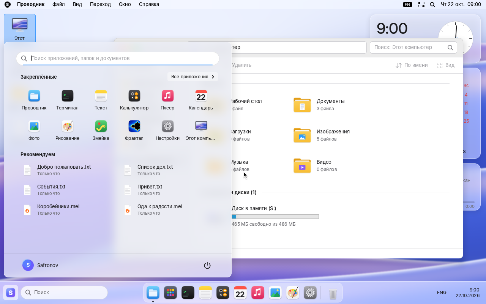
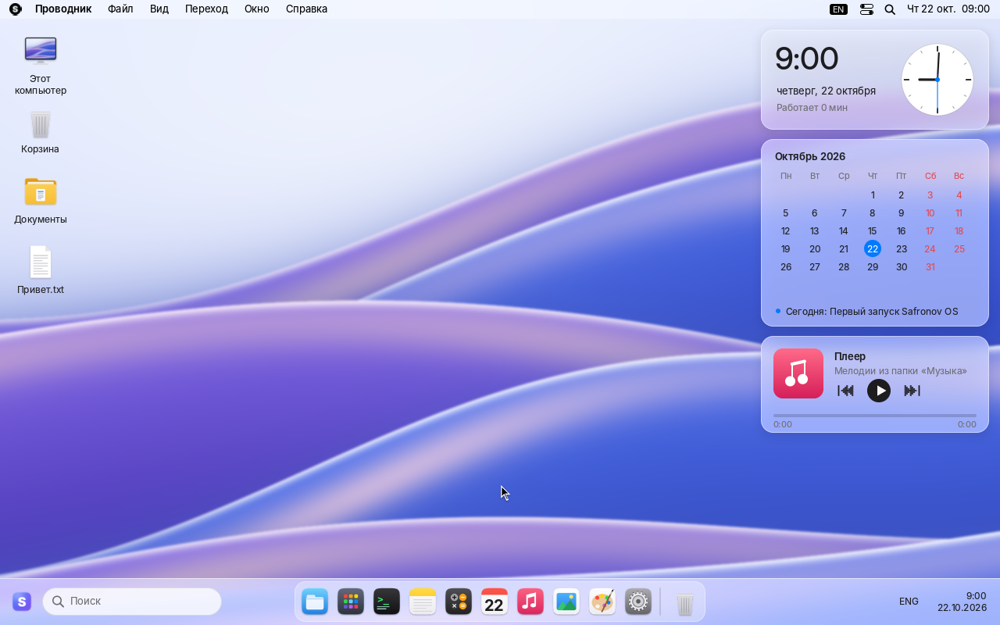
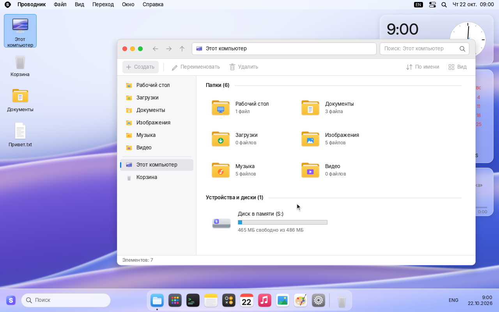
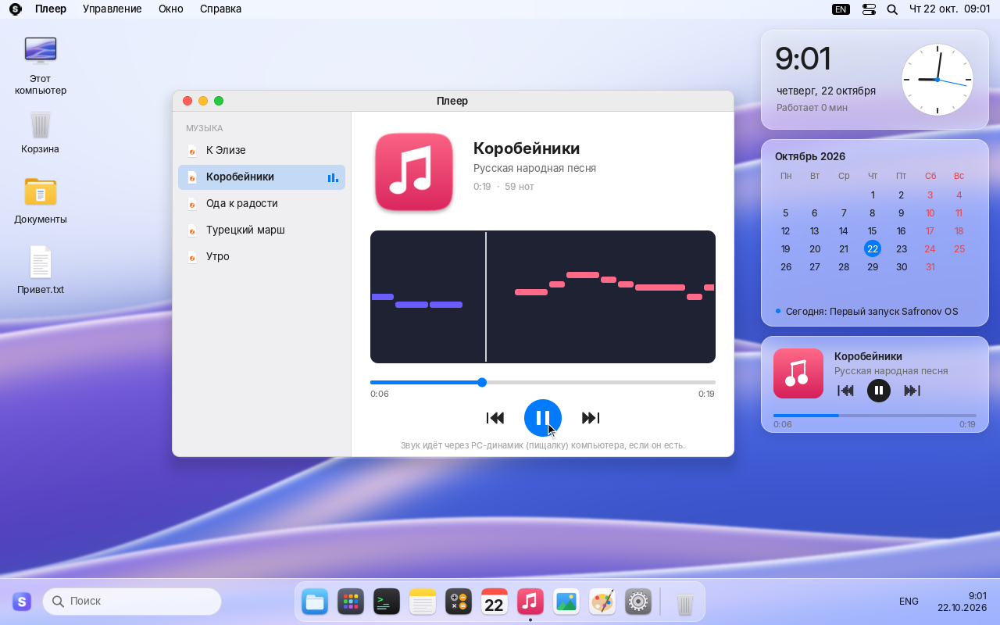
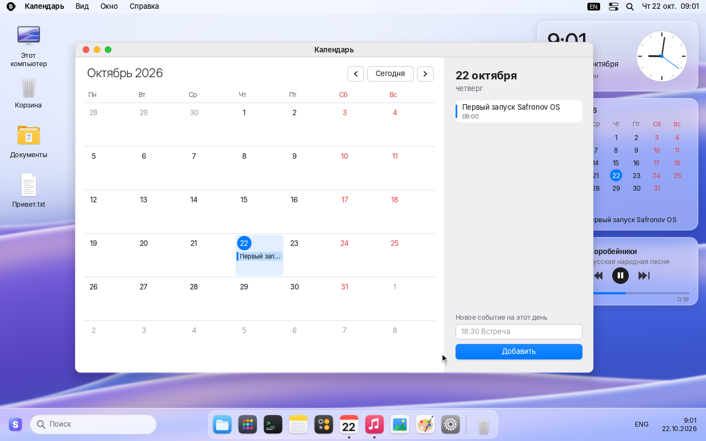
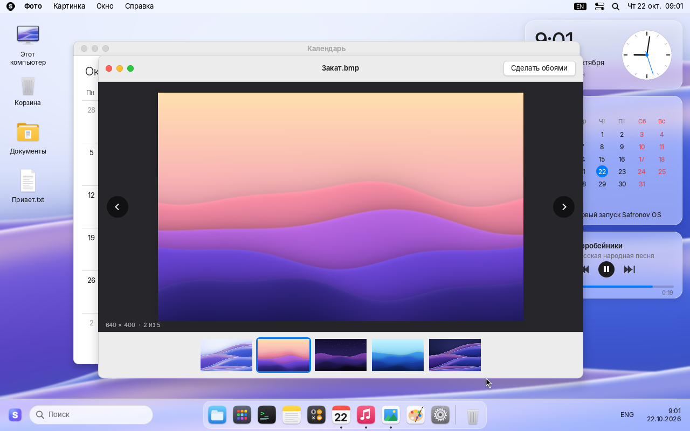
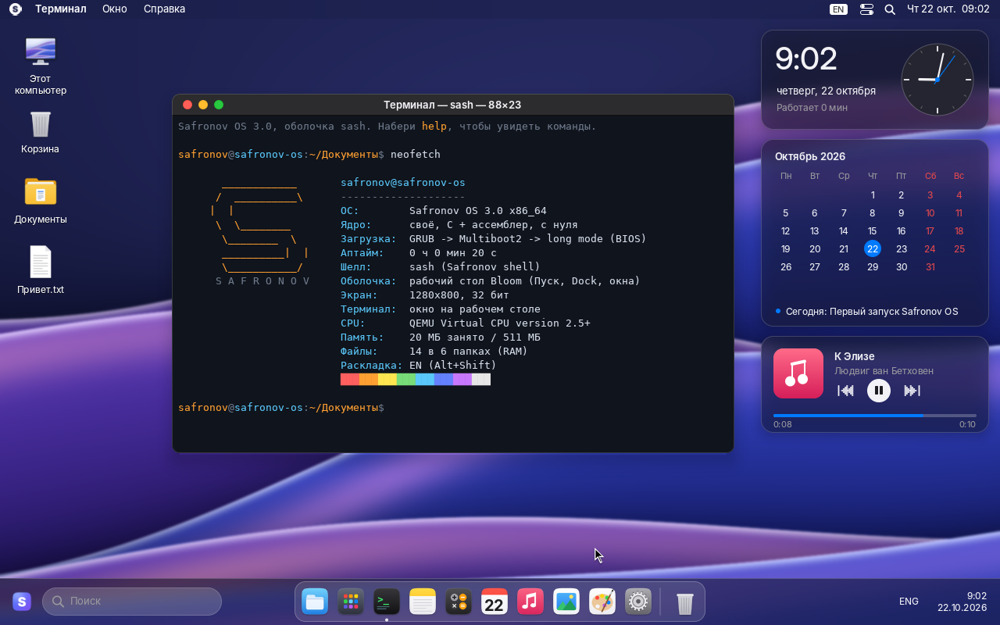
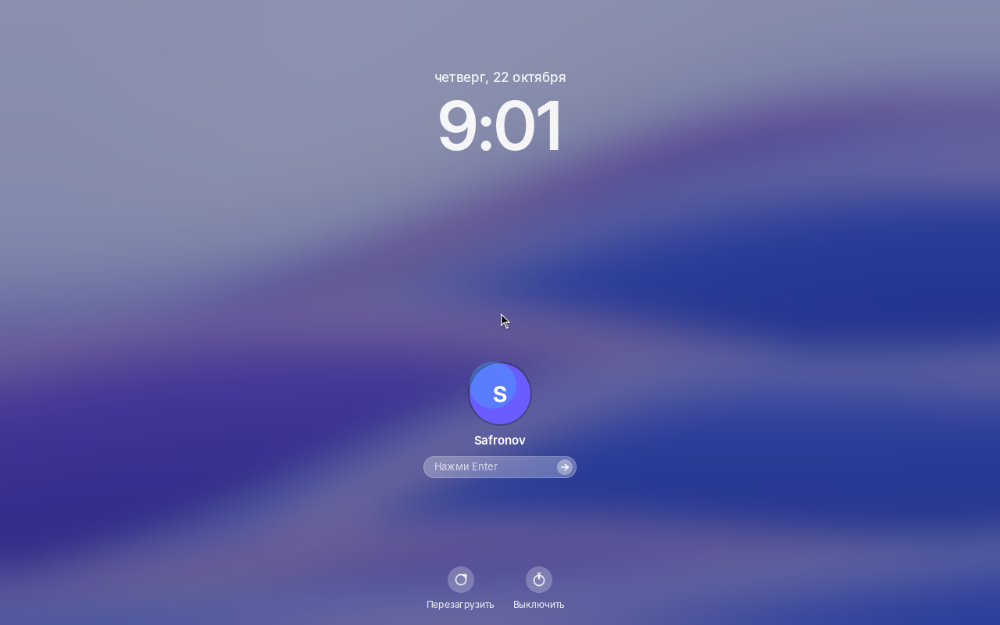

# Safronov OS 3.0 «Bloom»

Своя 64-битная операционная система с графическим рабочим столом, написанная с
нуля на C и ассемблере: своё ядро, свои драйверы, свой оконный менеджер, свои
программы. Linux внутри нет. По виду это смесь macOS и Windows 11: строка меню и
Dock как в macOS, меню «Пуск», панель задач и «Проводник» как в Windows 11.

Система грузится с флешки на обычном ПК (x86-64) в режимах **UEFI** и **BIOS
(Legacy/CSM)**, работает целиком в оперативной памяти и не трогает диски
компьютера: Windows или Linux на жёстком диске останутся как были.





| | |
|---|---|
|  |  |
|  |  |
|  |  |

## Что есть

**Рабочий стол**
- Обои Bloom из полупрозрачных «лепестков»; в тёмной теме они сами становятся тёмными.
- Строка меню сверху (меню системы и программ, раскладка, Пункт управления,
  Spotlight, часы).
- Панель задач снизу: кнопка «Пуск», поиск, Dock по центру (увеличение значков,
  подпрыгивание при запуске, точки у запущенных программ), раскладка и часы с датой.
- **Меню «Пуск»** как в Windows 11: поиск по программам, папкам и файлам,
  «Закреплённые», «Все приложения» по алфавиту, «Рекомендуем» — последние файлы
  с настоящим временем изменения, пользователь и кнопка питания.
  Открывается кнопкой на панели или клавишей **Win**.
- Значки на рабочем столе: «Этот компьютер», «Корзина», «Документы» и всё, что
  лежит в папке «Рабочий стол».
- Виджеты справа: часы со стрелками, календарь месяца с ближайшим событием и плеер.
- Окна со скруглёнными углами, тенями и кнопками-«светофорами»; анимации открытия,
  сворачивания «джинном» в Dock и разворачивания; Launchpad (F4), Spotlight с
  калькулятором (Ctrl+Пробел), Alt+Tab, светлая и тёмная темы, 7 цветов акцента.
- Чёткая картинка на больших экранах: от 2560×1600 и на 4K всё рисуется в 2×.

**Программы**
- **Проводник** — как в Windows 11: панель навигации, назад/вперёд/вверх, адресная
  строка, поиск, команды «Создать», «Переименовать», «Удалить», сортировка, значки
  и таблица, «Этот компьютер» с папками и диском (полоска заполнения считается по
  настоящей памяти), перетаскивание файлов в папки и в Корзину.
- **Плеер** — играет мелодии `.mel` из папки «Музыка» через PC-динамик; ноты бегут
  по «пианоролу», музыка играет дальше, пока работаешь в других окнах.
- **Календарь** — месяц, сегодняшний день, события из файла
  `Документы/События.txt`, добавление событий.
- **Фото** — картинки BMP из папок, лента миниатюр, «Сделать обоями».
- **Рисование** — кисти, цвета, ластик, сохранение рисунка в «Изображения».
- **Текст**, **Терминал** (оболочка sash: `ls`, `cd`, `cat`, `play`, `neofetch`,
  `calc`, …), **Калькулятор**, **Змейка**, **Фрактал**, **Настройки**.

**Файлы** лежат в папках «Рабочий стол», «Документы», «Загрузки», «Изображения»,
«Музыка», «Видео» и живут в оперативной памяти до перезагрузки.

**Железо**: своя работа с памятью, прерываниями, таймером, часами RTC, ACPI
(выключение и перезагрузка), клавиатура и мышь PS/2, свой драйвер USB (xHCI) для
USB-клавиатур и мышей (в том числе через хабы и с горячим подключением), PC-динамик.

## Чего нет (честно)

Это настоящая ОС, но маленькая: нет браузера, интернета и Wi‑Fi, нормального звука
(только PC-динамик — «пищалка», которой во многих новых ПК и ноутбуках нет),
драйверов дисков и видеоускорения. Программы от Windows, macOS и Linux не
запускаются. Сенсорные панели ноутбуков, подключённые по I2C, могут не работать —
тогда нужна USB-мышь. Погоды, Wi‑Fi и батареи на экране нет, потому что система их
не знает, а показывать выдуманные цифры незачем.

Значки, логотип и обои нарисованы программой `tools/mkassets.py` с нуля; логотипов
и значков Microsoft и Apple в системе нет.

## Как записать флешку

Нужен файл `safronov-os-3.0.iso` (22 МБ) и флешка от 32 МБ. **Всё на флешке сотрётся.**

- **Windows — Rufus** (rufus.ie): выбери флешку и `safronov-os-3.0.iso`, нажми «Старт».
  Когда Rufus спросит про режим записи ISOHybrid, выбери **«Записать в режиме DD-образа»**.
- **Windows / macOS / Linux — balenaEtcher**: Flash from file → образ → флешка → Flash.
- **Linux**: `sudo dd if=safronov-os-3.0.iso of=/dev/sdX bs=4M status=progress conv=fsync`
- **macOS (Терминал)**: `diskutil unmountDisk /dev/diskN`, затем
  `sudo dd if=safronov-os-3.0.iso of=/dev/rdiskN bs=4m`

## Как загрузиться

1. Вставь флешку, перезагрузи ПК и сразу жми клавишу меню загрузки:
   F12 (Dell, Lenovo, Acer, Gigabyte), F11 (MSI, ASRock), F8 (ASUS), Esc или F9 (HP).
   Выбери флешку — с пометкой UEFI или без, работают оба режима.
2. **Secure Boot должен быть выключен** (в настройках BIOS/UEFI → Security или Boot):
   загрузчик не подписан ключом Microsoft.
3. Через пару секунд появится логотип Safronov OS, затем экран входа. Нажми Enter.

Если что-то не так, сразу после выбора флешки нажми **Esc**: откроется меню
загрузки, в нём `Advanced options`:

| Проблема | Что выбрать |
|---|---|
| Картинка растянута или мелкая | `native screen resolution` или `safe video 800x600` |
| Не работает USB-клавиатура или мышь (UEFI) | `no own USB driver` и включи *Legacy USB Support* в BIOS |
| Не работает USB-клавиатура (Legacy/CSM) | `force own USB keyboard driver` |
| Рабочий стол не запускается | `text mode (terminal only)` — система в текстовом режиме |

Компьютеры Mac на Apple Silicon (M1–M4) загрузить x86-систему не могут.

## Клавиши

| Клавиши | Что делают |
|---|---|
| Win | меню «Пуск» |
| Ctrl+Пробел (или Win+Пробел) | Spotlight |
| F4 | Launchpad |
| Alt+Tab | переключение программ |
| Ctrl+W / Ctrl+M / Ctrl+Q | закрыть окно / свернуть / завершить программу |
| F10 | меню системы в строке меню |
| Alt+Shift или Ctrl+Shift | раскладка EN/RU |
| Ctrl+Alt+Del | перезагрузка |

В Проводнике: F2 — переименовать, Del — в Корзину, Backspace — на уровень вверх,
Alt+← — назад, Ctrl+N — новый документ, просто печатай — поиск.

## Мелодии для Плеера

Файл `.mel` в папке «Музыка» — обычный текст, его можно написать в «Тексте»:

```
# Подпись под названием
темп 120
E5/4 D5/8 C5/8 R/4 G4/2.
```

Нота — буква (A–G), `#` или `b`, октава; после `/` длительность (1, 2, 4, 8, 16),
точка делает ноту в полтора раза длиннее, `R` — пауза.

## Сборка из исходников (Linux)

```sh
sudo apt install build-essential nasm grub-pc-bin grub-efi-amd64-bin grub-common \
                 xorriso mtools qemu-system-x86 ovmf
make            # -> build/safronov-os.iso
make run        # QEMU, BIOS
make run-uefi   # QEMU, UEFI
make run-usb    # QEMU, загрузка образа как USB-флешки
make usb DEV=/dev/sdX   # записать на флешку (спросит подтверждение)
make assets     # перерисовать шрифты, значки и обои (нужны python3-pil, numpy, шрифты Inter)
```

Параметры ядра для отладки: `text` (текстовый режим), `usb` / `nousb`,
`noaccel` (мышь без ускорения), `slowmo` (анимации в 6 раз медленнее).
`tools/qemu_shot.py` гоняет систему в QEMU без экрана: нажимает клавиши, двигает
мышь, кликает и делает скриншоты.

## Устройство

```
boot/grub.cfg        меню загрузчика
src/boot.asm         Multiboot2, страницы, переход в 64-бит, включение SSE
src/isr.asm          входы прерываний (с сохранением FPU/SSE)
src/kernel.c         kmain: порядок инициализации, экран загрузки
src/mm.c             куча, отображение MMIO (WC для видео, UC для устройств)
src/gfx.c            кадровый буфер, двойная буферизация, текстовый режим VGA
src/draw.c           2D: сглаживание, прозрачность, текст, картинки, размытие, тени
src/wm.c             оконный менеджер: композитинг, окна, анимации, панель задач, Dock, меню
src/startmenu.c      меню «Пуск»
src/widgets.c        значки на рабочем столе, виджеты часов, календаря и плеера
src/desktop.c        обои, экран входа, Launchpad, Spotlight, Пункт управления, диалоги
src/filetypes.c      типы файлов, размеры и даты для людей, BMP
src/player.c         секвенсор PC-динамика и Плеер; src/melody.c — формат .mel
src/app_*.c          программы: files (Проводник), calendar, photos, text, terminal,
                     calc, paint, snake, fractal, settings
src/kbd.c src/mouse.c src/usb.c    клавиатура, мышь, xHCI (USB HID)
src/idt.c src/timer.c src/acpi.c src/rtc.c src/fs.c    ядро, железо, файлы с папками
src/shell.c src/console.c src/apps.c src/edit.c        шелл sash и текстовый режим
tools/mkassets.py    генератор шрифтов, значков, курсора и обоев -> assets/assets.bin
```

Шрифты: Inter (© The Inter Project Authors) и DejaVu Sans Mono — SIL Open Font
License 1.1 / свободная лицензия DejaVu; Terminus Font — SIL OFL 1.1.
Мелодии в папке «Музыка» — народные и классические (общественное достояние).
