# SamOS — своя мобильная ОС с нуля

SamOS — операционная система для телефона в стиле iOS, написанная с нуля на C и
ассемблере AArch64. Внутри нет Linux, Android, BSD, libc, графических библиотек,
UI-фреймворков и шрифтовых движков. Код ядра, драйверов, графики и интерфейса — свой.

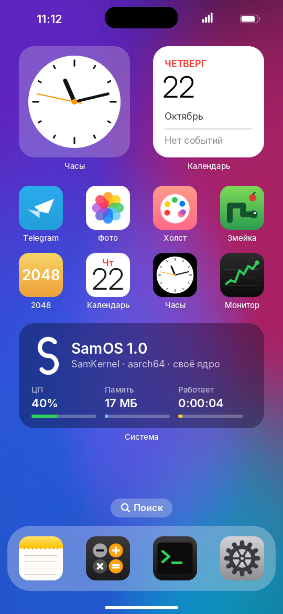

## Что внутри

| Слой | Что сделано |
|---|---|
| Загрузка | точка входа `_start`, спуск EL2 → EL1, стек, обнуление `.bss`, включение FPU/NEON |
| Ядро SamKernel | MMU (тождественное отображение, кэши), таблица векторов исключений, обработчик паник с дампом регистров, куча, журнал ядра (`dmesg`), разбор дерева устройств (DTB) |
| Прерывания | контроллер ARM GICv2, IRQ от таймера и устройств, сон процессора через `WFI`, пока ничего не происходит |
| Драйверы | UART PL011 (лог), RTC PL031 (часы), Generic Timer, видео ramfb (через fw_cfg DMA), virtio-input (сенсорный экран и клавиатура), PSCI (перезагрузка и выключение) |
| Графика | свой 2D-движок: сглаженные фигуры через SDF, скругления, градиенты, «матовое стекло» (размытие), тени, масштабирование, альфа-смешивание |
| Текст | свой рендер UTF-8 текста, кириллица, перенос строк |
| Оболочка | загрузочный экран, экран блокировки, домашний экран с виджетами и доком, Dynamic Island, пункт управления, жесты, анимации запуска и закрытия приложений, светлая и тёмная темы, четыре варианта обоев |
| Сеть | свой стек с нуля: драйвер virtio-net, Ethernet, ARP, IPv4, ICMP (ping), UDP, DHCP, DNS, TCP |
| Криптография | свои SHA-1, SHA-256, AES-256 (режимы IGE и CTR), большие числа с умножением Монтгомери (RSA-2048, Диффи-Хеллман-2048), факторизация pq (Поллард-Брент) |
| Telegram / MTProto | свой клиент протокола MTProto 2.0: TL-сериализация, транспорты (abridged/intermediate/full), рукопожатие создания `auth_key` (req_pq → RSA_PAD → Диффи-Хеллман), зашифрованный слой сообщений (msg_key, AES-IGE), приложение Telegram |
| Приложения | **Telegram** (свой MTProto), Калькулятор, Заметки (экранная клавиатура ЙЦУКЕН/QWERTY), Терминал (оболочка `samsh`), Настройки, Фото (фракталы и пейзажи генерируются на устройстве), Холст, Змейка, 2048, Календарь (праздники РФ), Часы (мировое время с летним временем и секундомер), Монитор системы |

Своего кода около 8000 строк. Ещё есть файл `gfx/fontdata.c` — его генерирует скрипт, это просто данные.

## Telegram и сеть

В SamOS нет готового сетевого стека — всё написано с нуля: драйвер сетевой карты,
TCP/IP и сам протокол Telegram (MTProto 2.0) с шифрованием. Приложение Telegram
выполняет **настоящее рукопожатие** с сервером: req_pq, разложение pq, шифрование
RSA_PAD публичным ключом Telegram, обмен Диффи-Хеллмана и согласование `auth_key`,
затем зашифрованный обмен сообщениями (AES-IGE на ключе, выведенном из `auth_key`).

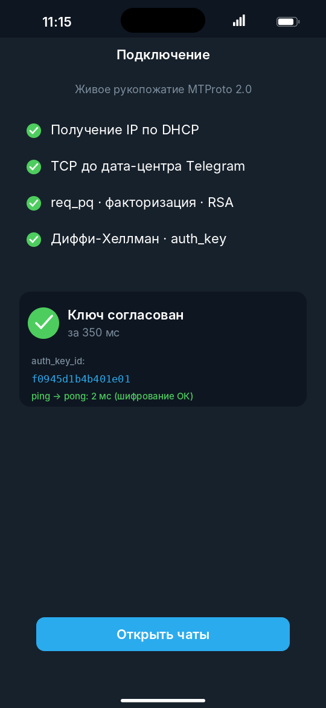

**Как это проверено.** Из этой среды сборки серверы Telegram недоступны (исходящий
прокси перехватывает порт 443 и ждёт TLS/HTTP). Поэтому:

- Криптография сверена с известными тест-векторами: `make check`
  (SHA-1/256, AES-256, AES-IGE, modpow RSA-2048 и Диффи-Хеллман-2048, факторизация pq).
- Весь протокол проверен end-to-end против **независимого MTProto-сервера на Python**
  (`tools/mtproto_server.py`, на библиотеке `cryptography`): SamOS и сервер
  независимо вычисляют один и тот же 256-байтный `auth_key`, после чего проходит
  зашифрованный `ping → pong`. Команда: `make mtprototest`, затем запуск сервера и
  образа (см. ниже).
- Нижние слои (DHCP, DNS, ICMP, TCP) проверены против живого интернета через QEMU:
  TCP-рукопожатие с дата-центром Telegram по IP проходит, HTTP-запрос к хосту работает.

На реальном телефоне (через Termux + QEMU) приложение дотянется до настоящих серверов
Telegram тем же кодом. Полноценный вход (ввод номера, SMS-код, список диалогов) —
следующий слой: он требует `api_id`/`api_hash` и ещё части TL-схемы API; сейчас
экран номера и список чатов показаны на демонстрационных данных, а криптоядро и
транспорт — настоящие.

Проверка протокола локально:

```sh
make mtprototest                        # сборка с тестовым ключом
python3 tools/mtproto_server.py 7777 &  # независимый MTProto-сервер на хосте
./run.sh -netdev user,id=n0 -device virtio-net-device,netdev=n0
# в логе ядра: «рукопожатие УСПЕХ», совпадающий auth_key_id и «ping → pong»
```

## Скриншоты

Все скриншоты в `screenshots/` сняты автотестом `tools/demo_test.py`. Он запускает
SamOS в эмуляторе, нажимает «пальцем», печатает, рисует и сохраняет экран.

| | | | |
|---|---|---|---|
| 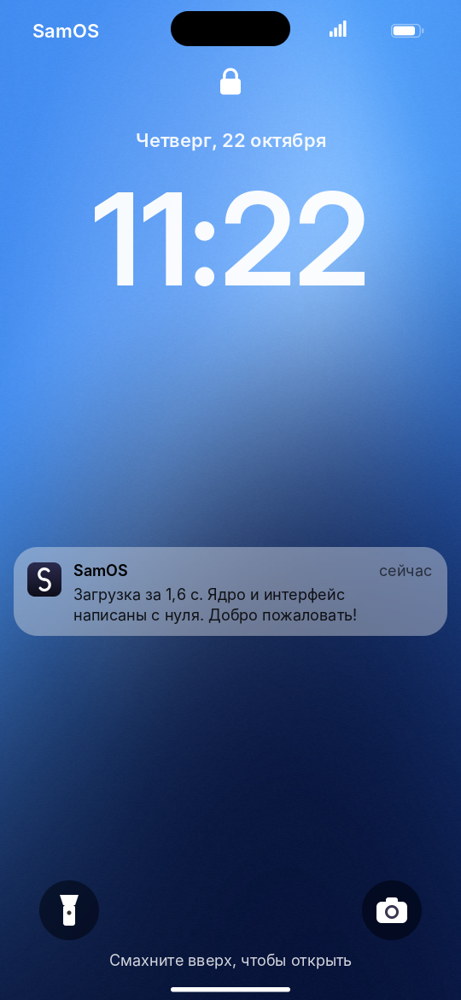 |  | 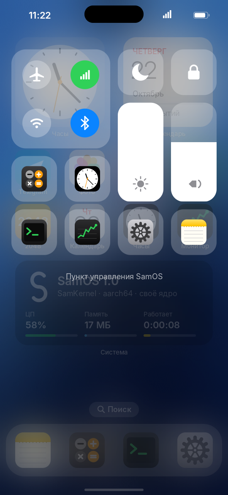 | 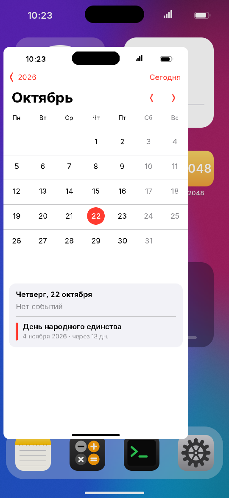 |
| 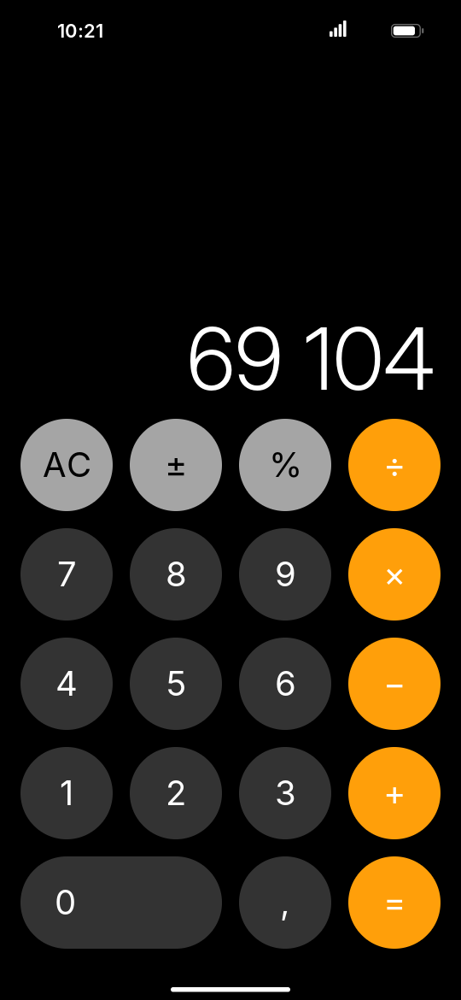 | 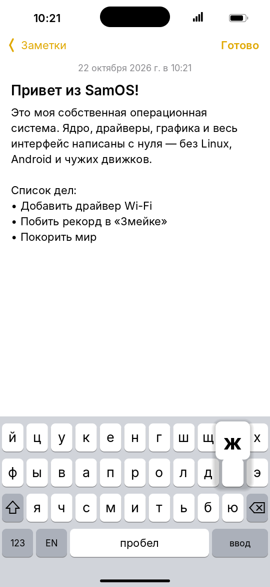 | 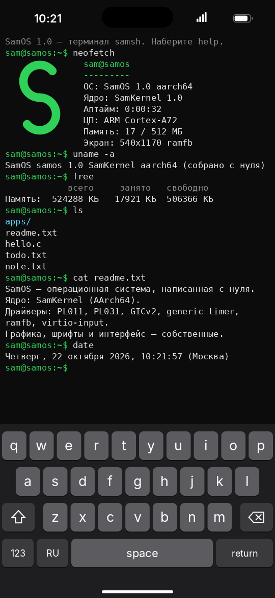 | 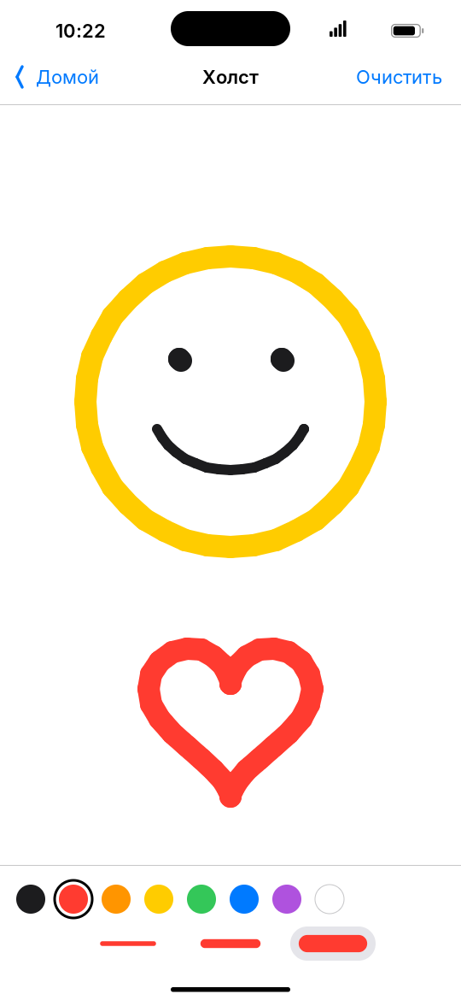 |
| 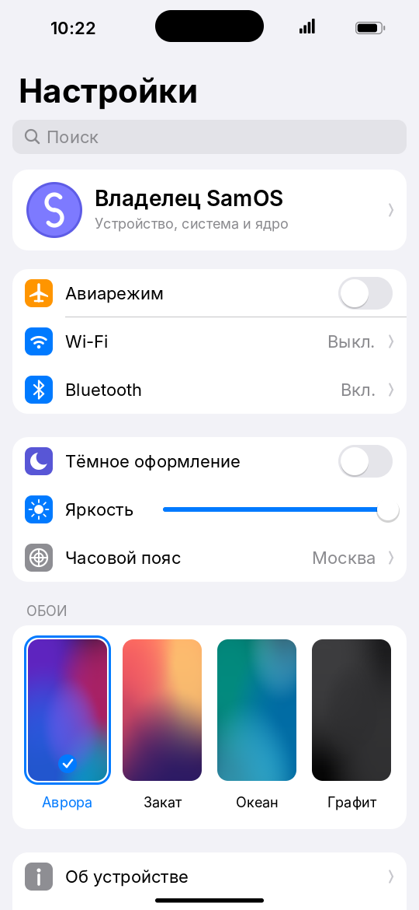 | 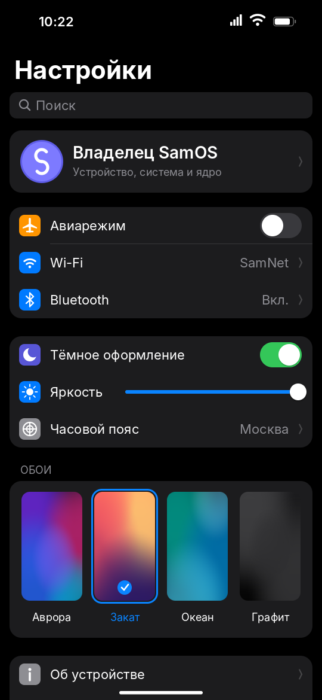 | 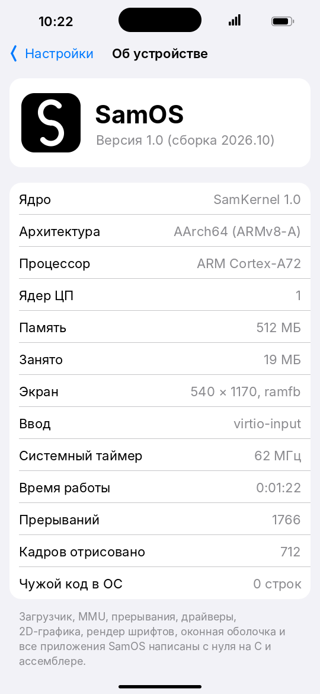 | 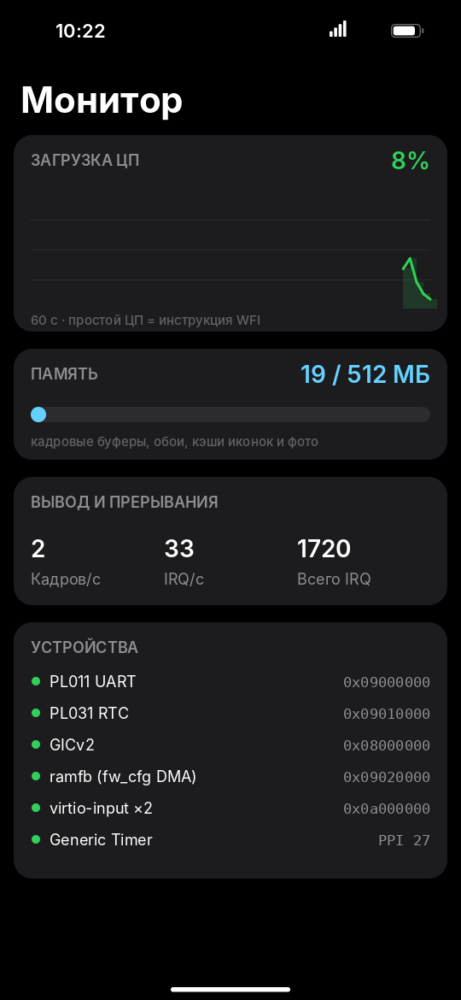 |
| 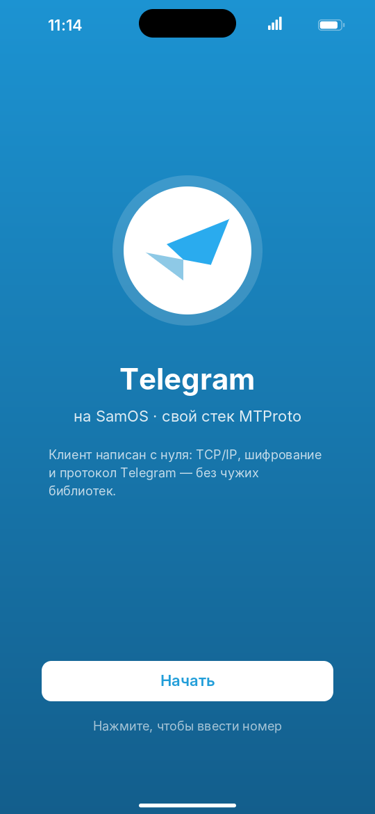 | 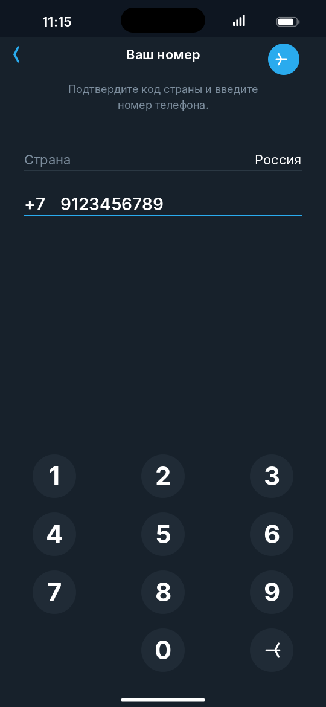 | 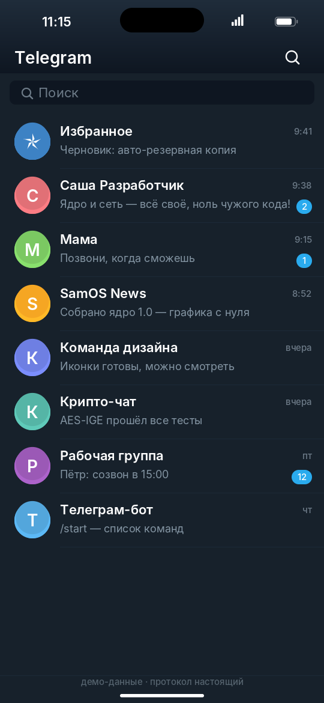 | 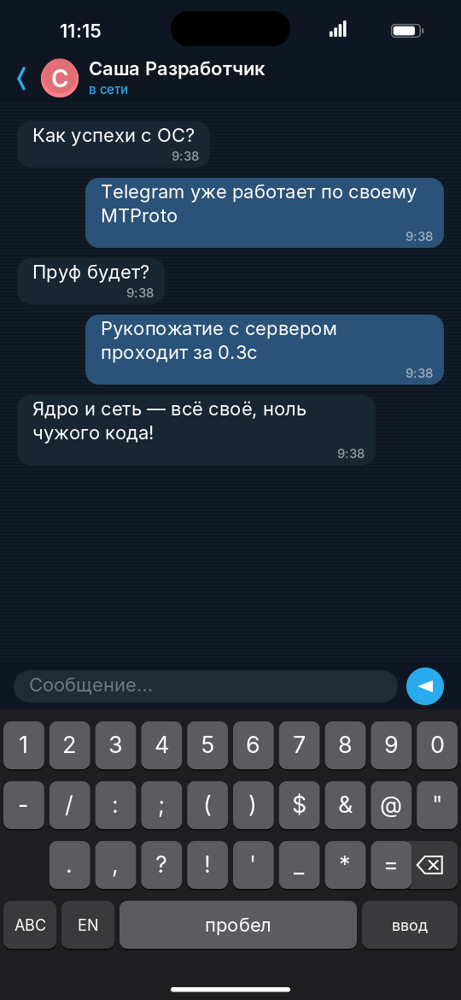 |

## Запуск на Android-телефоне

Root и разблокировка загрузчика не нужны. Телефон эмулирует «железо» для SamOS
через QEMU в Termux, а экран SamOS выводится в VNC-клиент. Касания пальцем доходят
до SamOS как касания сенсорного экрана.

1. Установите **Termux** (из F-Droid) и VNC-клиент: **AVNC**, **bVNC** или **RealVNC Viewer**.
2. В Termux выполните:
   ```sh
   pkg install qemu-system-aarch64-headless
   ```
3. Скопируйте на телефон папку `samos`. Нужны `dist/samos.elf` и `run-android.sh`.
4. Запустите:
   ```sh
   sh run-android.sh
   ```
5. В VNC-клиенте подключитесь к `127.0.0.1:5901`.

## Запуск на компьютере

Нужен QEMU (`qemu-system-aarch64`).

```sh
./run.sh          # Linux / macOS
run.bat           # Windows
```

Управление: мышь работает как палец. Свайп вверх от нижнего края или клик по полоске
внизу возвращает домой. Касание правого верхнего угла открывает пункт управления.
`Esc` — домой, `F1` — пункт управления, стрелки работают в играх.

## Сборка

Нужны `clang` и `ld.lld`. Это кросс-компилятор под aarch64, библиотеки он не подключает.

```sh
make            # build/samos.elf
make dist       # dist/samos.elf — готовый файл без отладочной информации
make test       # автотест со скриншотами (нужны QEMU и Python + Pillow)
make check      # проверка криптографии на тест-векторах (на хосте)
make mtprototest # сборка для проверки MTProto против локального сервера
make fonts      # перегенерировать растровые шрифты (нужен Pillow)
```

## Структура

```
kernel/   boot.S, vectors.S — старт и исключения; mmu, gic, irq, timer, fdt,
          fb (ramfb), virtio_input, uart, mem, lib (строки, printf)
gfx/      gfx.c — 2D-движок; font.c — текст; fontdata.c — растры глифов
net/      virtio_net — драйвер; net.c — Ethernet/ARP/IP/ICMP/UDP/DHCP/DNS;
          tcp.c — TCP; nettest.c — самопроверка сети
crypto/   sha1, sha256, aes (IGE/CTR), bn (большие числа), tg_keys (ключи Telegram)
mtproto/  mtproto.c — рукопожатие auth_key; mtp_crypto.c — зашифрованный слой
ui/       shell.c — оболочка и главный цикл; keyboard, widgets, icons,
          wallpaper, time (часовые пояса)
apps/     12 приложений (включая Telegram)
tools/    mkfont.py — генератор шрифтов; crypto_test.c — тест-векторы;
          mtproto_server.py — независимый сервер для проверки MTProto;
          qemu_driver.py, demo_test.py — автотесты со скриншотами
```

## Что взято не с нуля

- **Компилятор.** Код собирается `clang`. Это инструмент сборки, в саму ОС он ничего не добавляет.
- **Шрифты.** Используются начертания Inter и DejaVu Sans Mono (свободные лицензии SIL OFL
  и Bitstream Vera). Скрипт `tools/mkfont.py` один раз при сборке превращает их в
  картинки-маски. Внутри ОС шрифтового движка нет, буквы рисует свой код.
- **«Железо».** SamOS сейчас работает на виртуальной ARM-плате QEMU `virt`. Это
  эмулятор устройства, как Android Emulator для Android. Сама ОС его кодом не пользуется.

## Как поставить прямо на телефон вместо Android

На реальный телефон эта сборка «прошиваться» пока не умеет. У каждой модели свой
контроллер дисплея, свой сенсорный экран и своя карта памяти, а драйверы для них
закрыты. Для нативного запуска нужно:

1. Разблокировать загрузчик телефона.
2. Портировать SamOS под конкретную модель: адреса памяти, GICv3, экран
   (simple-framebuffer, который оставляет загрузчик) и драйвер сенсора для этой модели.
3. Временно загрузить образ через `fastboot boot`. Это запуск без прошивки, поэтому
   родной Android остаётся на месте.

Это следующий шаг, и он делается отдельно под каждую модель.
